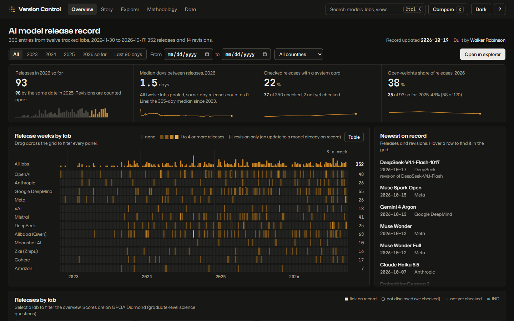

# Version Control

Version Control is a public record of AI model releases from twelve labs since ChatGPT launched on 2022-11-30: when each model shipped, how the public can use it, what it scored on two pinned benchmarks, and which disclosure documents the lab published. A static site renders the record, and a nightly pipeline in this repository finds new releases and queues them for a person to approve.

Live site: [versioncontrol.walker-robinson.com](https://versioncontrol.walker-robinson.com)



## How it works

1. **Detection.** The nightly pipeline reads four sources: lab announcement feeds and news pages, organization-scoped Hugging Face listings, the OpenRouter catalog, and Epoch AI's models dataset (`pipeline/detectors/`). Signals about one model are grouped into one candidate, and anything already on record is dropped (`pipeline/correlate.py`).
2. **Drafting and research.** A small language model drafts each candidate's entry under a hard monthly spend cap (`pipeline/extract.py`, `pipeline/spend.py`). Code checks every draft: a benchmark number without full provenance is rejected (`pipeline/validate.py`), and a summary that fails the voice lint (`pipeline/lint_voice.py`) is dropped for a person to rewrite while the structured fields are kept. Disclosure links for the record built from Epoch AI's data were researched with AI tools; the evidence from the October 2026 research is in `docs/evidence/`.
3. **Human approval.** Candidates wait on a review branch. A person marks each one approved, `promote` turns approved candidates into entries, the workflow regenerates the story, and merging the branch is publication (`pipeline/pending.py`, `pipeline/promote.py`, `.github/workflows/promote.yml`). Disclosure links publish only from approved rows in `content/disclosure_links/`.
4. **Static site.** The record is gzipped JSON, one file per year, with a checksummed manifest (`data/`). The pages in `site/` read those files directly; `pipeline/derive.py` precomputes the comparisons, and `pipeline/build_story.py` generates the story page from the data. GitHub Pages serves the site with the CSV files, sitemap and llms.txt built at deploy (`pipeline/site_files.py`).

## Honesty rules (enforced in code)

- Every benchmark score names its source (lab-reported or independent), URL, benchmark version and retrieval date, or it is not published.
- A missing document is recorded as "not disclosed" only after we checked the lab's pages; "not yet checked" is our own gap and never enters a percentage.
- A change against the previous model is shown only when both scores share the benchmark, its version and the kind of source; otherwise the entry says no change is shown, and why.

The full rules, the scope and the known limits are in `docs/METHODOLOGY.md`, which mirrors the site's methodology page. To report an error in the record, open an issue: https://github.com/wrobinson127/versioncontrol/issues/new

## Commands

```
python -m pytest -q                       # 326 tests
python -m pipeline.validate               # every entry against the schema and provenance rules
python -m pipeline.build_story --check    # fail if site/story.html has drifted from the data
python tools/check_pages.py .             # browser checks on every page (Playwright + Chromium)
python tools/check_explorer.py .          # browser checks on the explorer
```

CI runs the tests, the manifest-drift guard, `validate` and `build_story --check` on every push (`.github/workflows/ci.yml`).

## Licensing

- Code: MIT (`LICENSE`).
- Published dataset (the JSON and CSV files): CC-BY 4.0, with the required attribution for fields derived from Epoch AI (`DATA_LICENSE.md`).

Maintained by [Walker Robinson](https://walker-robinson.com).
